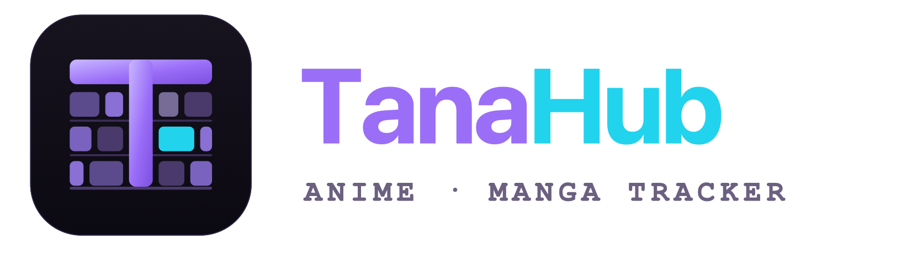

<div align="center">



**A native desktop tracker for anime and manga.**<br>
No Electron. No web wrapper. Just .NET and Avalonia rendering straight to Skia.

[](https://github.com/Komortes/TanaHub/actions/workflows/ci.yml)


</div>

---

## Why it exists

Every anime tracker on the desktop is a browser in a box — slow to start, heavy in memory, and full of tells that give away the `<div>` underneath. TanaHub is the counter-argument: the same feature set, built native, with an interface that behaves like it belongs on the OS.

It is also a working portfolio piece. The architecture is meant to be read: clean layering, a swappable infrastructure boundary, and a test suite that covers the parts that matter. The visual system follows the same rule — a near-black indigo surface ramp, one primary accent used sparingly, three semantic signal hues, and a monospace stack reserved exclusively for numeric data. Every choice should be defensible, not default.

---

## Features

### Track

- **Library** — Watching, Completed, Planning, Paused, Dropped, with per-title progress, scores, and personal notes
- **Manga progress** — chapter and volume tracking alongside episode counts
- **Ratings & reviews** — your own score and long-form review, stored per title
- **Custom lists & tags** — organise beyond the five built-in statuses
- **Statistics** — episodes watched, chapters read, hours tracked, and distribution charts

### Discover

- **Search & browse** — anime via the AniList GraphQL API, manga via MangaDex
- **Title detail** — synopsis, characters, relations, airing info, and your notes in one view
- **Schedule** — what is airing this week, and when
- **Recommendations** — local suggestions derived from the genres already in your library

### Recognise

- **From a screenshot** — identify an anime and the exact timestamp via [trace.moe](https://trace.moe)
- **From artwork** — trace an illustration back to its source and artist via [SauceNAO](https://saucenao.com)
- **History** — past recognition attempts are kept so you can revisit a match

### Sync & data

- **AniList import** — connect via OAuth and pull your anime and manga lists in
- **MAL import/export** — read and write MyAnimeList XML backups (file-based; there is no live MAL account sync)
- **CSV export** — dump the whole library for a spreadsheet
- **Offline cache** — catalog data is cached locally, so the app opens and works with no connection
- **Update checks** — tells you when a newer GitHub release is out

---

## Tech stack

| Layer | Technology |
|---|---|
| Runtime | .NET 10 |
| UI | Avalonia UI — native, Skia-rendered, cross-platform |
| Anime catalog | AniList GraphQL API |
| Manga catalog | MangaDex REST API |
| Anime recognition | trace.moe API |
| Artwork recognition | SauceNAO API |
| Library storage | SQLite via EF Core |
| Settings & cache | Local JSON, encrypted at rest where sensitive |
| Architecture | Clean Architecture — Domain / Application / Infrastructure / UI |

---

## Architecture

```
src/
  TanaHub.Desktop/          Entry point, DI composition root
  TanaHub.UI/               Views, ViewModels, controls (Avalonia MVVM)
  TanaHub.Application/      Use cases, service interfaces, CSV export
  TanaHub.Infrastructure/   API clients, SQLite, sync, notifications
  TanaHub.Domain/           Core models and enums

tests/
  TanaHub.Application.Tests/
  TanaHub.Infrastructure.Tests/
```

The application core has zero knowledge of AniList, MangaDex, or any other external service — it only knows the interfaces in `TanaHub.Application/Services`. Adding a new catalog source means implementing one of them and registering it in the composition root.

Design decisions are recorded as ADRs in [`docs/decisions/`](docs/decisions).

---

## Getting started

**Requirements:** .NET SDK 10.0.201 or newer.

```bash
git clone https://github.com/Komortes/TanaHub.git
cd TanaHub

dotnet restore TanaHub.sln
dotnet build TanaHub.sln
dotnet run --project src/TanaHub.Desktop/TanaHub.Desktop.csproj
```

```bash
dotnet test TanaHub.sln
```

The app runs with no configuration. Two optional integrations need credentials, entered in **Settings**:

| Integration | What you need | Where to get it |
|---|---|---|
| AniList sync | Client ID + Client Secret | [AniList developer settings](https://anilist.co/settings/developer) |
| SauceNAO artwork lookup | API key | [saucenao.com](https://saucenao.com/user.php) |

trace.moe screenshot recognition works without a key, subject to its public rate limits.

---

## Releasing

Run the [smoke test checklist](docs/smoke-test.md) against a clean local data profile before cutting a release artifact. Packaging steps live in [docs/release.md](docs/release.md).

---

## Security note

Your AniList Client Secret and OAuth access token are stored in `settings.json` in the app-data folder, encrypted at rest with a per-installation AES-256-GCM key. That key lives in `.settings.key` in the same folder, with owner-only permissions on macOS and Linux.

This protects against casual exposure — a settings file swept into cloud sync, or a backup read by another tool. It is **not** a substitute for an OS keychain: anyone with read access to both files under your OS user account can still decrypt the values. Do not commit or share your app-data folder.

---

## License

MIT — see [LICENSE](LICENSE).
