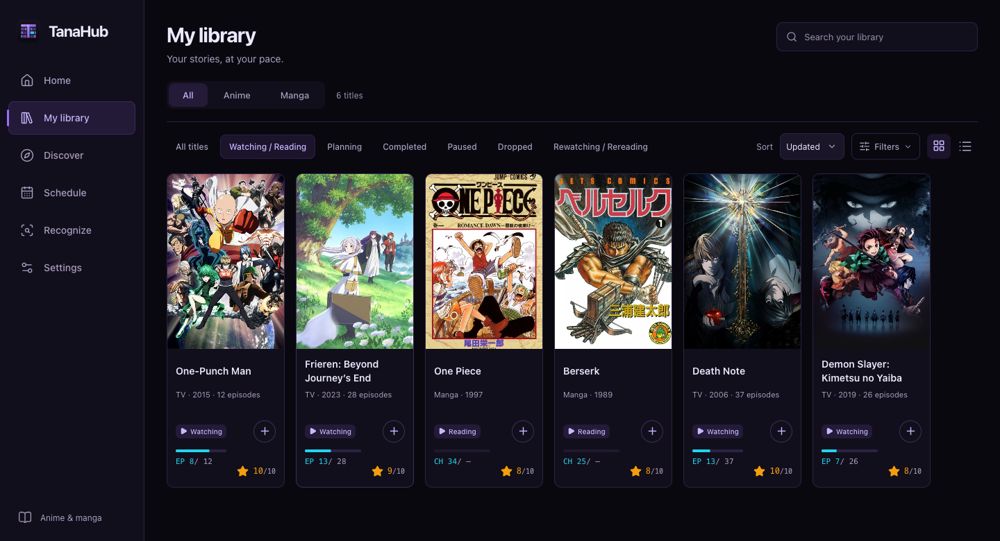
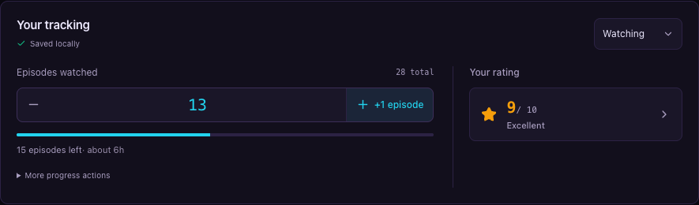

<div align="center">


**Your anime and manga library, on your desktop.**<br>
Track your progress, rate your favourites and keep your next watch close.

[](https://github.com/Komortes/TanaHub/releases/tag/v0.1.0) [](https://github.com/Komortes/TanaHub/actions/workflows/ci.yml) [](LICENSE)

[**Download preview**](#getting-started) · [User guide](docs/getting-started.md) · [Run from source](#run-from-source) · [Contributing](CONTRIBUTING.md)

</div>



<p align="center"><sub>The current desktop interface, shown with a sample library.</sub></p>

TanaHub brings anime and manga into one local library. Find titles, save what you want to watch or read, and pick up where you left off. **No account is required** to browse catalogs and track your collection. Your library is stored locally in SQLite; online catalogs and image recognition need an internet connection.

## Getting started

Download **[TanaHub 0.1.0 Preview](https://github.com/Komortes/TanaHub/releases/tag/v0.1.0)** for your platform:

| Platform | Installer |
|---|---|
| **macOS 15+ · Apple Silicon** | [Download DMG](https://github.com/Komortes/TanaHub/releases/download/v0.1.0/TanaHub-0.1.0-osx-arm64.dmg) |
| **Windows · x64** | [Download EXE](https://github.com/Komortes/TanaHub/releases/download/v0.1.0/TanaHub-0.1.0-win-x64.exe) |
| **Linux · x64** | [Download DEB](https://github.com/Komortes/TanaHub/releases/download/v0.1.0/TanaHub-0.1.0-linux-x64.deb) · [Download AppImage](https://github.com/Komortes/TanaHub/releases/download/v0.1.0/TanaHub-0.1.0-linux-x64.AppImage) |

Packages include the .NET runtime. You do not need Node, Rust or a .NET SDK to use the app. SHA-256 checksums and an alternative macOS app archive are on the release page.

> [!NOTE]
> This is an early preview. macOS builds are ad-hoc signed and not notarized; Windows installers are unsigned. Automated builds and core checks pass on all three platforms; interactive Windows/Linux installation checks are still pending. Read the [installation instructions](docs/getting-started.md#install-or-run) for OS trust warnings, AppImage setup and backing up an existing library.

### Your first title

1. Open **Discover** and search for an anime or manga.
2. Choose **Add to library**, then record your progress and personal rating. Source builds start Watching or Reading with your first episode/chapter; in **0.1.0 Preview**, choose that status manually.
3. Return to **My library** to filter your collection and continue watching or reading.

See the [user guide](docs/getting-started.md) for imports, exports, backups and optional integrations.

## Inside the app

- **Track at your pace.** Episode, chapter and volume progress; watching/reading statuses; 0–10 personal ratings; editable tracking dates.
- **Make it your collection.** Notes, reviews, tags, custom lists, search, sorting and grid/list views.
- **Find your next story.** AniList anime and manga, optional MangaDex manga, characters, related titles, recommendations and airing schedules.
- **Find the source of an image.** Anime screenshots through [trace.moe](https://trace.moe), artwork through [SauceNAO](https://saucenao.com), with recognition history.
- **Bring your list with you.** AniList library import, MyAnimeList XML import/export and CSV export. AniList import is one-way.
- **Keep tracking locally.** SQLite storage, saved catalog data, high-contrast theme and keyboard navigation. Updates are installed manually from GitHub releases.

<details>
<summary><strong>Your progress and rating, up close</strong></summary>



A closer look at the tracking panel on a title page. Record an episode, see what remains, and keep your personal rating alongside your progress. [About these screenshots](docs/screenshots/README.md).

</details>

## Run from source

The commands below run a development checkout.

### Requirements

- [.NET SDK](https://dotnet.microsoft.com/download) compatible with [global.json](global.json), currently 10.0.201 with `latestFeature` roll-forward.
- Node.js 24 or newer and npm.
- Rust stable and the [Tauri prerequisites for your OS](https://v2.tauri.app/start/prerequisites/).
- The macOS Tauri client targets macOS 15 or newer. Windows and Linux builds must be made on their target hosts.

### New desktop client

```sh
git clone https://github.com/Komortes/TanaHub.git
cd TanaHub/src/TanaHub.Client
npm run doctor
npm ci
npm run desktop:dev
```

`npm run desktop:build` publishes the .NET sidecar and packages the current host's desktop client. Packaged users do not need the .NET SDK or runtime. Packaging, signing limits and checksums are described in [the release guide](docs/release.md).

For browser development, run `npm run prepare:bridge` and then `npm run dev`. The local frontend opens at `http://127.0.0.1:1420`; the packaged app uses native IPC.

### Existing Avalonia client

From the repository root:

```sh
dotnet restore TanaHub.sln
dotnet run --project src/TanaHub.Desktop/TanaHub.Desktop.csproj
```

### Optional integrations

Credentials are entered in **Settings**, not in repository files.

| Integration | Credentials |
|---|---|
| AniList import | Client ID and Client Secret from [AniList developer settings](https://anilist.co/settings/developer) |
| SauceNAO artwork lookup | API key from [SauceNAO](https://saucenao.com/user.php) |
| trace.moe screenshots | No key required for the public API; provider limits apply |

## Development checks

<details>
<summary><strong>Build, test and native validation commands</strong></summary>

From the repository root:

```sh
node scripts/check-release-version.mjs
node --test scripts/tests/release.test.mjs
node --test scripts/tests/environment.test.mjs
dotnet restore TanaHub.sln
dotnet format TanaHub.sln --verify-no-changes --no-restore
dotnet build TanaHub.sln -c Release
dotnet test TanaHub.sln -c Release --no-build
```

From `src/TanaHub.Client`:

```sh
npm run build
npm run test:transport
npm run prepare:bridge
npm run test:core
npx playwright install chromium
npm test
cargo check --locked --manifest-path src-tauri/Cargo.toml
```

Browser tests use controlled fixtures; the core test uses a real self-contained sidecar and an isolated profile. See [CONTRIBUTING.md](CONTRIBUTING.md) for testing without changing your library.

</details>

## Repository map

The desktop UI uses **Tauri 2, Svelte 5 and TypeScript** with a self-contained **.NET 10** sidecar. Domain, Application and Infrastructure remain shared with the original Avalonia client. Both clients use the same SQLite library; avoid editing one profile from both at once. See [migration status](docs/tauri-migration.md) and [architecture decisions](docs/decisions).

<details>
<summary><strong>Project structure</strong></summary>

| Path | Purpose |
|---|---|
| `src/TanaHub.Client` | Svelte frontend, Tauri shell and browser tests |
| `src/TanaHub.Bridge` | JSON stdio adapter to the .NET services; [protocol reference](src/TanaHub.Bridge/README.md) |
| `src/TanaHub.Desktop`, `src/TanaHub.UI` | Existing Avalonia client and its composition root |
| `src/TanaHub.Application` | Use cases, service contracts and library insights |
| `src/TanaHub.Infrastructure` | Catalogs, recognition, SQLite, imports, settings and caches |
| `src/TanaHub.Domain` | Core models and enums |
| `tests` | Application, Infrastructure and Bridge .NET test projects |
| `docs` | Release guide, smoke checks, migration notes and [architecture decisions](docs/decisions) |
| `scripts` | Release version checks, asset collection and legacy Avalonia publishing |

</details>

## Data and security

Local data is stored under the OS application-data directory in `TanaHub/`. Use an absolute `TANAHUB_DATA_DIRECTORY` to run with a separate profile. Back up the directory while the app is closed before testing another build.

Sensitive settings use AES-256-GCM with a per-installation `.settings.key` stored beside `settings.json`. The key has owner-only permissions on macOS and Linux. Anyone who can read both files under your OS account can decrypt the values; this is not an OS keychain. Never share an app-data directory or include credentials in issue reports. See [SECURITY.md](SECURITY.md).

## Get involved

[Report a bug](https://github.com/Komortes/TanaHub/issues/new/choose) · [Suggest a feature](https://github.com/Komortes/TanaHub/issues/new/choose) · [Contribute](CONTRIBUTING.md) · [Documentation](docs/README.md)

TanaHub is open source under the [MIT license](LICENSE).
